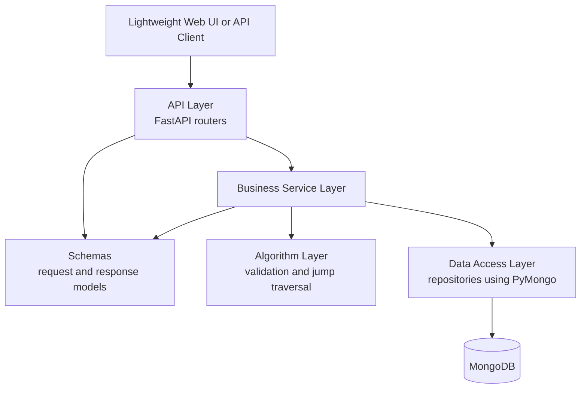
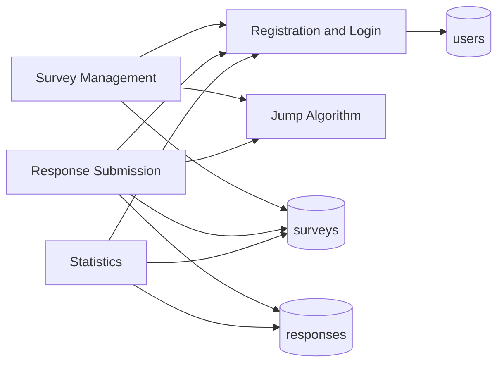
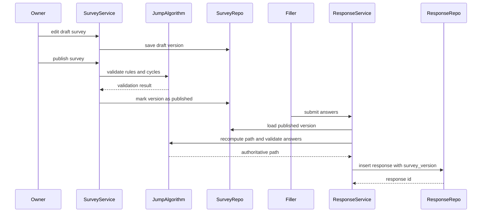

# System Design

This document describes the first-stage system design and its implemented boundaries. It is based on the FastAPI + PyMongo application and the course assignment requirements.

The concrete API list is maintained in `docs/api.md`; this document explains layer responsibilities and data flow.

## Current Project State

Current implemented code:

- FastAPI application startup and lifespan management.
- Environment configuration for MongoDB URI and database name.
- PyMongo client creation, database access, ping, and client closing.
- `/health` and `/health/db` endpoints.
- Registration/login, survey CRUD and versioning, publishing/closing, shared filling, submission validation, and statistics.
- Health-check tests, algorithm tests, and core API business tests.

The first-stage limitations are `start_question_id`, in-progress answer sessions, and raw response export. A lightweight browser frontend is served at `/`; Swagger UI remains available for complete API inspection.

## Layered Architecture

## Layer Responsibilities

### API Layer

Responsibilities:

- Define FastAPI routes.
- Parse authentication context.
- Validate request bodies using schemas.
- Call service functions.
- Convert service results and business errors to HTTP responses.
- Never perform direct MongoDB queries.
- Never expose raw response documents containing internal anonymous identity fields.

### Business Service Layer

Responsibilities:

- Enforce application rules.
- Coordinate repositories and algorithms.
- Check permissions and ownership.
- Hash and verify passwords through a password utility.
- Create survey versions and enforce immutable published versions.
- Recompute answer paths during submission.
- Convert duplicate-key errors to domain errors.

### Algorithm Layer

Responsibilities:

- Validate question definitions.
- Validate answer values.
- Resolve the next question from jump rules.
- Validate completed answer paths.
- Detect conservative jump cycles before publication.
- Stay independent from FastAPI and PyMongo.

### Data Access Layer

Responsibilities:

- Encapsulate PyMongo collection operations.
- Convert between MongoDB documents and service-layer dictionaries or domain objects.
- Maintain indexes through migration/setup scripts or explicit setup functions later.
- Avoid business decisions such as permission checks or jump evaluation.

## Module Dependency Relationships

Dependency notes:

- Survey management depends on authentication because each survey has an owner.
- Response submission depends on authentication because the confirmed anonymity strategy still requires login.
- Response submission depends on the jump algorithm to validate the actual path.
- Statistics depends on ownership checks and response aggregation.
- The jump algorithm depends only on survey definition and submitted answers, not on repositories.

## Core Service Interfaces

- `register()` and `login()`: normalize usernames, enforce uniqueness, store password hashes, and issue bearer tokens.
- `create_survey()`, `update_survey()`, `publish_survey()`, and `close_survey()`: manage ownership, versions, validation, deadlines, and lifecycle state.
- `submit_response()`: load the published version, recompute the answer path, enforce duplicate policy, and persist the response.
- `calculate_statistics()`: check ownership and aggregate the requested survey version or question without exposing respondent identity.

## Authentication, Permission, And Anonymous Boundaries

Authentication:

- Fillers must log in before submitting responses.
- Survey owners must log in before creating, editing, publishing, or viewing statistics.

Permission checks:

- A user can view and manage only surveys where `surveys.owner_user_id` equals their authenticated user ID.
- A user can submit only to a published, open survey available through a valid share slug or survey ID.
- Statistics endpoints must check survey ownership before aggregating responses.

Anonymous boundary:

- Internal response records contain `respondent_user_id` for login-required validation and duplicate control.
- Owner-facing anonymous response views must not expose `respondent_user_id`, username, raw `submission_key`, or raw `anonymous_identity_key`.
- Repeated submission control is independent from anonymity and is governed by `allow_multiple_submissions`.

## Survey Version And Submission Flow

Submission invariants:

- Responses store the survey version used at submission time.
- Published versions are immutable.
- Historical responses remain interpretable after later survey edits.
- The client cannot decide which questions were legally skipped; the server recomputes the path.

## Verification

Unit and API tests cover authentication, versions, jump priority, answer validation, path recomputation, duplicate submission, deadlines, closing, and four question-type statistics. Real HTTP and isolated MongoDB verification is recorded in `business-test-report.md`.
